<h3 align="center">Hi, I'm Ashish John</h3>

<strong>.NET Backend Developer</strong> C# · ASP.NET · VB.NET · SQL Server · REST APIs

  <h3><code>ashish@github ~ $ ./contributions</code></h3>
  
    
  <h3><code>ashish@github ~ $ whoami</code></h3>
  <table>
    <tr>
      <td valign="top"></td>
      <td valign="top"></td>
    </tr>
  </table>

### What I work with

| Area | Level | Practical experience |
| :--- | :--- | :--- |
| .NET, ASP.NET and VB.NET | Intermediate to advanced | C#, ASP.NET Core, Web API, MVC, REST APIs and legacy application maintenance |
| SQL Server | Intermediate | T-SQL, stored procedures, views, triggers and data access |
| Angular | Beginner with practical experience | Creating pages and data tables, fixing bugs and integrating .NET APIs |
| AI with .NET | Beginner | Foundational learning through Coursera |

I work on backend services and business applications, including CRM workflows, authentication, role-based authorization and production defect resolution. I also have experience with Azure Functions, Git/TFS and Agile delivery.

### Building GHAR

I'm building **GHAR**, a household-management application.

[Explore GHAR](https://hlb-api-ashish-abfxf7fxbgewgdej.centralindia-01.azurewebsites.net/login)

### Learning and certification

**Building AI-Powered Applications with .NET — Coursera**

I'm continuing to develop my Angular skills and beginner-level knowledge of AI with .NET.

### Connect

[LinkedIn](https://www.linkedin.com/in/ashish-john-078b62199/) · [GitHub repositories](https://github.com/ashu-ashishjohn?tab=repositories)

---

Terminal-style profile inspired by <a href="https://www.avivashishta.com/blog/build-animated-github-profile-readme">Avi Vashishta's guide</a>. SVGs are stored in this repository. The contribution graph uses GitHub's public calendar and refreshes daily.
